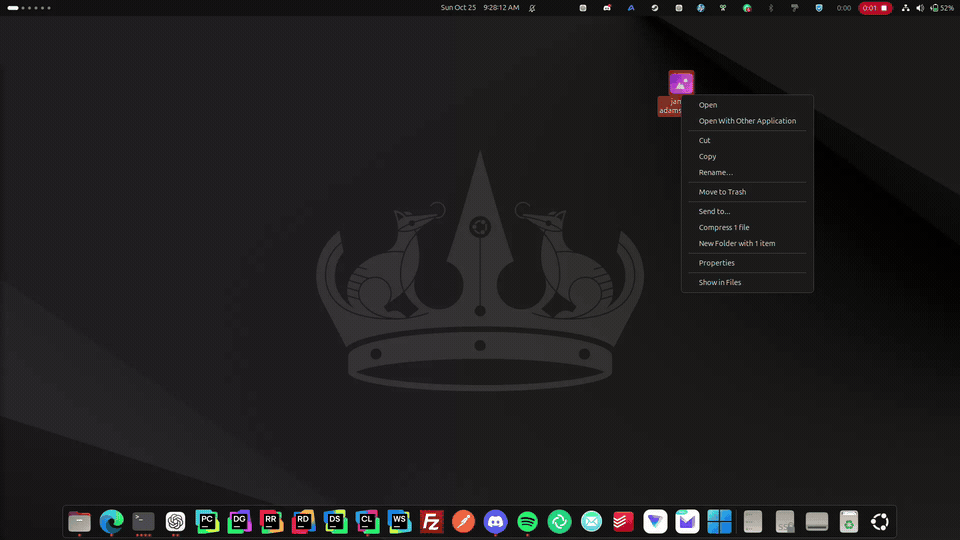
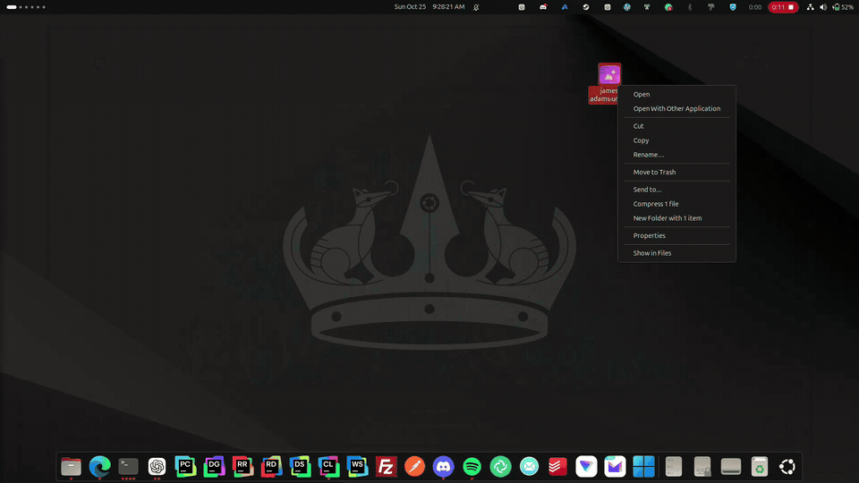
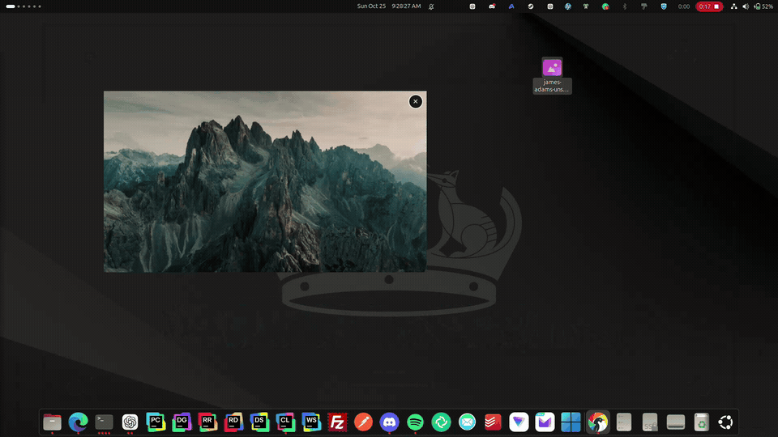
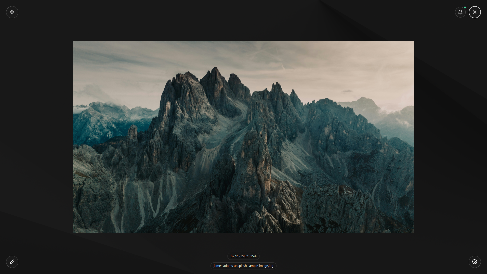
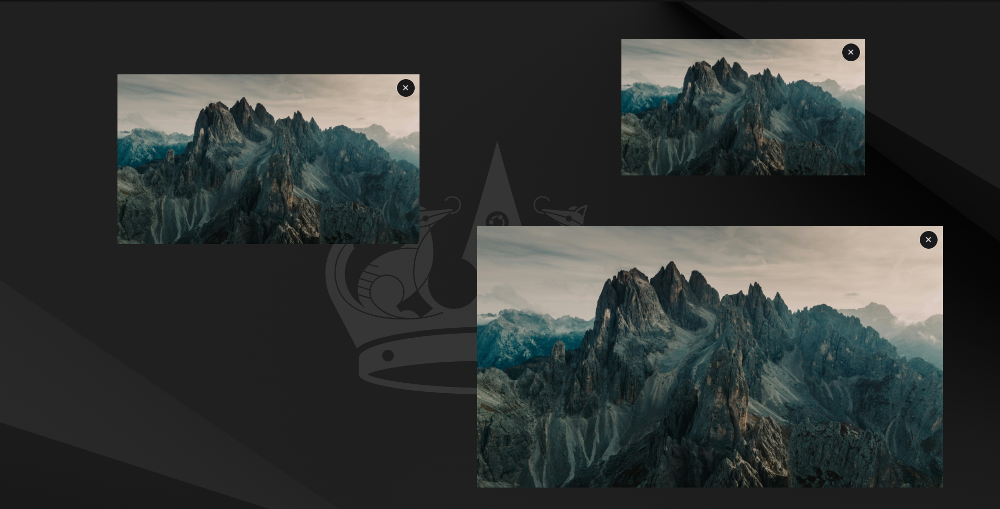
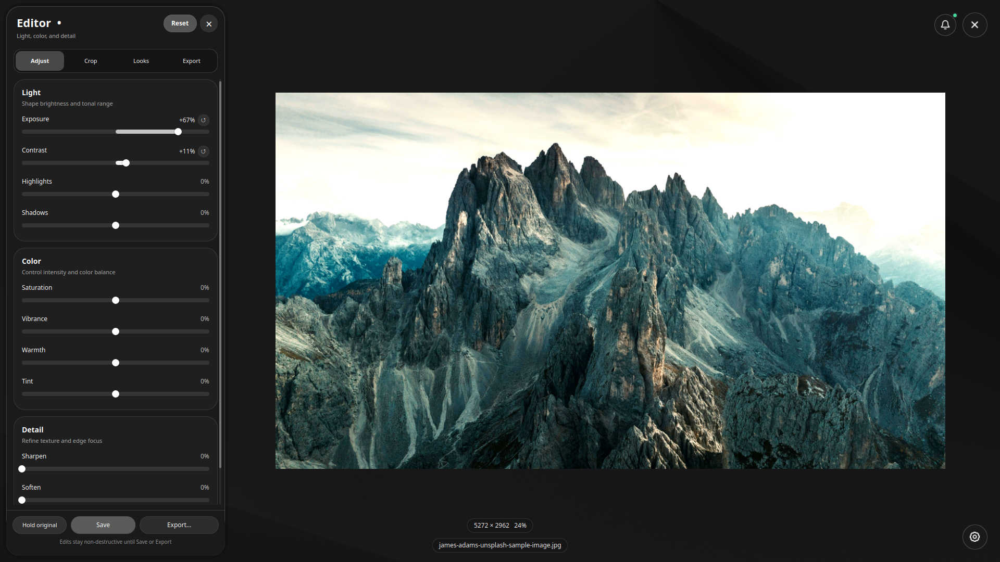

<p align="center">

</p>

[](https://github.com/sanxchep/licasa/actions/workflows/ci.yml)
[](https://github.com/sanxchep/licasa/releases)
[](https://github.com/sanxchep/licasa/graphs/commit-activity)
[](LICENSE)

# Licasa

Licasa is an image viewer and editor for the Linux desktop inspired by Google's Picasa Photo Viewer. It opens a photo from your file manager in an image-sized fullscreen window or in a floating mode.

**Licasa is an independent open-source project and is not affiliated with or endorsed by Google.**

## Try Licasa

**[Download published releases](https://github.com/sanxchep/licasa/releases)** · [0.8.0 release notes and measured results](packaging/release-notes/v0.8.0.md)

**0.8.0** combines 27 runtime optimisations with installation and graphics fixes.
- View photos fullscreen or in a floating window, then crop, adjust, and export them.
- Open JPEG, PNG, TIFF, WebP, HEIC/HEIF, JPEG XL, AVIF, JPEG 2000, and RAW previews.
- Play Motion Photos and animated APNG files.

If you try it, [report a bug or suggest a feature](https://github.com/sanxchep/licasa/issues/new).

## In action

**Open a photo** — From the desktop into the fullscreen viewer.



**Resize a floating window** — Open a photo, move it, and resize it on the desktop.



**Keep multiple windows open** — Open additional views and arrange floating windows.



## Screenshots

<details>
<summary>Fullscreen viewer, floating windows, and photo editor</summary>

**Fullscreen viewer** — View your photos with minimal controls.



**Floating windows** — Keep multiple photos open on your desktop.



**Photo editor** — Adjust light, color, and detail, then save or export.



</details>

## Install

### Ubuntu 24.04 (amd64)

Download `licasa_0.8.0-1_amd64.deb` and its `.sha256` file. APT installs the required system libraries:

```sh
sha256sum -c licasa_0.8.0-1_amd64.deb.sha256
sudo apt install ./licasa_0.8.0-1_amd64.deb
```

### Fedora 44 (x86-64)

Download `licasa-appimage-0.8.0-1.fc44.x86_64.rpm` and its `.sha256` file:

```sh
sha256sum -c licasa-appimage-0.8.0-1.fc44.x86_64.rpm.sha256
sudo dnf install ./licasa-appimage-0.8.0-1.fc44.x86_64.rpm
```

### Arch Linux (x86-64)

Download `licasa-appimage-0.8.0-1-x86_64.pkg.tar.zst` and its `.sha256` file:

```sh
sha256sum -c licasa-appimage-0.8.0-1-x86_64.pkg.tar.zst.sha256
sudo pacman -U ./licasa-appimage-0.8.0-1-x86_64.pkg.tar.zst
```

The release also includes a `PKGBUILD` for people who prefer to build the Arch package themselves. The `.pkg.tar.zst` file above is ready to install.

### AppImage (recent x86-64 desktops)

Download `Licasa-0.8.0-x86_64.AppImage`, `install-licasa-appimage.sh`, and both `.sha256` files:

```sh
sha256sum -c Licasa-0.8.0-x86_64.AppImage.sha256
sha256sum -c install-licasa-appimage.sh.sha256
bash install-licasa-appimage.sh ./Licasa-0.8.0-x86_64.AppImage
```

The AppImage requires 64-bit Intel or AMD Linux with glibc and compatible desktop libraries. ARM and 32-bit systems need a different package. The installer explains missing system tools, extraction failures, and missing or incompatible libraries before replacing an existing installation. If a library check fails, keep the error output when reporting the problem.

If installation or startup fails, the updated installer can produce a support report before Licasa starts:

```sh
bash install-licasa-appimage.sh --diagnose ./Licasa-0.8.0-x86_64.AppImage > licasa-support.txt
```

You can omit the AppImage filename to inspect an existing per-user or native installation. This does not start Licasa, execute the downloaded AppImage, extract it, or use the network. It reports the system, desktop/session, missing tools, FUSE availability, destination permissions/mount flags, and installed-library failures. Environment values and photo paths are omitted; review the report before sharing. Exit status 1 means it found a problem; 0 means the checks it could perform passed, not a guarantee that a graphical launch will work.

Installation and removal also retain a private log at `$XDG_STATE_HOME/licasa/installation.log` (normally `~/.local/state/licasa/installation.log`), with one rotated copy. It includes local installation paths and error output. Nothing is uploaded. The diagnostics and logging described here require the updated installer from this source revision; the previously published 0.7.1 installer does not include them.

### Snap (systems with Snapd)

For automatic Store updates, install from the stable channel:

```sh
sudo snap install licasa
```

A directly installed candidate Snap uses `licasa_0.8.0_amd64.snap` and its `.sha256` file:

```sh
sha256sum -c licasa_0.8.0_amd64.snap.sha256
sudo snap install --dangerous ./licasa_0.8.0_amd64.snap
```

In **Settings**, turn on **Background process** if you want faster repeat opens. Licasa then stays ready when you close its window and starts in the background at your next desktop login, including after a reboot. This is off by default. Turning it off removes the login startup entry; closing Licasa then exits it. This works through your desktop session, so it does not start before you log in.

If Licasa has trouble, its private error log is at `$XDG_STATE_HOME/licasa/errors.log` (normally `~/.local/state/licasa/errors.log`; inside the Snap's user data for Snap installs). It records warnings and errors, keeps one rotated copy, and never uploads anything. Log messages can include photo paths, so review the file before attaching it to a bug report.

## Update

For Debian, Fedora, Arch, or AppImage, download the newer files and repeat the matching installation steps above with the new filenames. Close Licasa before updating an AppImage installation; the installer replaces its per-user files and launcher.

Store-installed Snaps update automatically. To switch an existing Snap to the beta channel, run `sudo snap refresh licasa --beta`. A directly installed `.snap` file requires another manual download and `sudo snap install --dangerous ./<new-file>.snap` after checking its checksum.

## Uninstall

Use the command for the package you installed:

```sh
sudo apt remove licasa             # Ubuntu .deb
sudo dnf remove licasa-appimage    # Fedora RPM
sudo pacman -R licasa-appimage     # Arch package
sudo snap remove licasa            # Snap
```

For a per-user AppImage installation, use its saved removal script:

```sh
bash "$HOME/.local/opt/licasa-appimage/install-licasa-appimage.sh" --uninstall
```

## Build the Linux packages

From the repository root, with Docker installed:

```sh
docker build -f packaging/build-deb.Dockerfile -t licasa-deb-builder packaging
mkdir -p build/deb-output
docker run --rm -v "$PWD:/source:ro" -v "$PWD/build/deb-output:/output" \
  licasa-deb-builder bash /source/packaging/verify-fresh-build.sh
```

The `.deb`, AppImage, and SHA-256 files appear in `build/deb-output/`. Docker is required only to build these packages from source. To check the local files:

```sh
(cd build/deb-output && sha256sum -c licasa_0.8.0-1_amd64.deb.sha256)
(cd build/deb-output && sha256sum -c Licasa-0.8.0-x86_64.AppImage.sha256)
(cd build/deb-output && sha256sum -c install-licasa-appimage.sh.sha256)
```

## Verify desktop launches

Maintainers can use `tools/verify_linux_vm_desktop.py` with a disposable QEMU/KVM guest running a normal GNOME or Plasma Wayland login through GDM or SDDM. Install the desktop, Python/Pillow, GTK's `gtk-launch`, desktop-file-utils, xdg-utils, and the appropriate GNOME/KDE file-handler tools in the guest. Install the candidate AppImage with the updated installer and install the native package separately. Keep Qt's platform and graphics backend overrides unset.

Inside that disposable guest only, create its qualification marker:

```sh
sudo install -m 644 /dev/null /etc/licasa-disposable-qualification
```

Expose the guest's SSH port on localhost and QEMU's QMP socket in a dedicated results directory shared with QEMU as `/vm`. Use a task-specific SSH key and known-hosts file. From the source checkout on the host:

```sh
python3 tools/verify_linux_vm_desktop.py \
  --port 46601 --identity ./vm/key --known-hosts ./vm/known_hosts \
  --qmp ./vm/qmp.sock --desktop gnome --variant appimage \
  --guest-appimage /home/qualifier/Licasa-0.8.0-x86_64.AppImage \
  --output ./reports/gnome-appimage
```

Repeat for `--desktop kde` and `--variant native` or `portable`. The `appimage` variant checks the per-user installation; `portable` checks the raw FUSE-mounted AppImage using a temporary test desktop entry inside the guest. `--install-home` can select an AppImage installation made under a deliberately awkward test path. Each case checks desktop-entry activation, opening a photo through the desktop's default file handler, reopening with a photo, and normal shutdown. Reports include versions, artifact hashes and screenshots; black frames or a running process alone do not pass. Failures retain their report and output.

The worker refuses ordinary hosts, containers, root accounts, and unmarked guests. The runner does not provision a VM or connect to the host's display, session bus or GPU. Discard the guest after collecting evidence. VM results cover the tested desktop session and virtual graphics device; physical graphics drivers and other host policies still need separate qualification.

### Physical graphics checks

Automatic Wayland launches prefer OpenGL ES to avoid a reproduced black-window failure in the bundled Qt desktop OpenGL path on NVIDIA. Explicit Qt graphics selections remain honored; X11 keeps its existing defaults. The diagnostic uses the same selection as the viewer.

`tools/verify_appimage_graphics.py` checks a real GPU through a private Weston Wayland session. First run the Fedora/Arch AppImage installation qualification above the graphics layer, then build the matching test image:

```sh
python3 tools/verify_appimage_fedora.py ./build/deb-output/Licasa-0.8.0-x86_64.AppImage \
  --output ./reports/fedora-installation.json
docker build -f packaging/verify-graphics-fedora.Dockerfile -t licasa-graphics-fedora .
python3 tools/verify_appimage_graphics.py \
  --appimage ./build/deb-output/Licasa-0.8.0-x86_64.AppImage \
  --image licasa-graphics-fedora --render-node /dev/dri/renderD129 \
  --output ./reports/fedora-graphics
```

Choose an already accessible render node for the GPU being tested. For Arch, use `tools/verify_appimage_desktops.py` for installation qualification and `packaging/verify-graphics-arch.Dockerfile` for the graphics image. The graphics images build a checksum-pinned Weston 15.0.1 GL capture module with a narrow asynchronous row-order fix. This corrects an independently reproduced headless screenshot inversion on NVIDIA; the module belongs only to the qualification image and is never bundled with Licasa. The build retains source, patch and module hashes in `/usr/share/licasa-qualification/weston-capture-build.json`.

The runner forwards that render device to a non-root container with a read-only root, no capabilities, and no network, host display, input devices or session bus. It clears rendering/library overrides and first checks raw capture orientation with an independent `weston-image` fixture, then closes that fixture and verifies it has disappeared. It checks both the diagnostic and normal AppRun launcher, their actual renderer names, the application's GPU descriptors, visible photo pixels and normal shutdown. Missing or inverted calibration prevents application qualification; raw PNGs remain unchanged. Software rendering, llvmpipe, missing evidence or a software retry fails the accelerated gate. Explicit software/fallback checks remain separate in the ordinary package qualification.

`--nvidia` requires a test image with NVIDIA userspace matching the installed kernel driver. It maps the selected GPU's NVIDIA device/control nodes and exposes its primary DRM node as metadata only, with device-cgroup read/write access denied and checked before graphics starts. It grants no primary-node or modesetting I/O. A renderer name alone still cannot pass the photo assertion. An inverted photo is reported separately from absent pixels and still fails orientation qualification; raw captures are retained unchanged. These tests qualify the distribution's userspace against the current host kernel/GPU driver; they do not replace a native GNOME/KDE login test with that distribution's kernel. Use a fresh output directory for each artifact/environment comparison; failed runs retain an explicitly failed report.

## License

Licasa's first-party source is licensed under the [BSD 2-Clause License](LICENSE). Third-party components and test fixtures have their own licenses, which are retained with the distributed materials.
